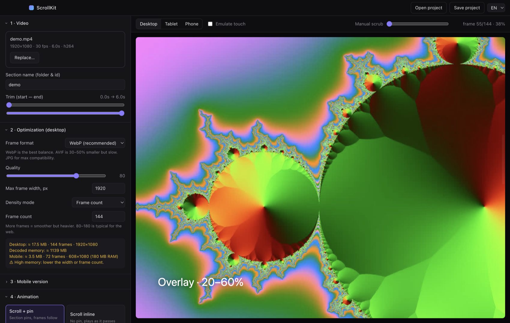
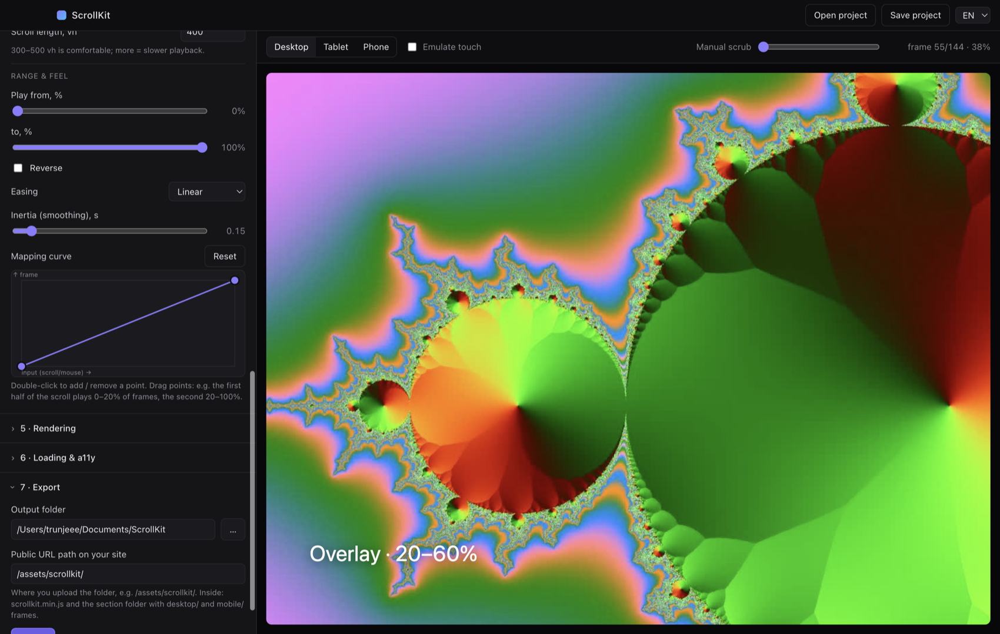
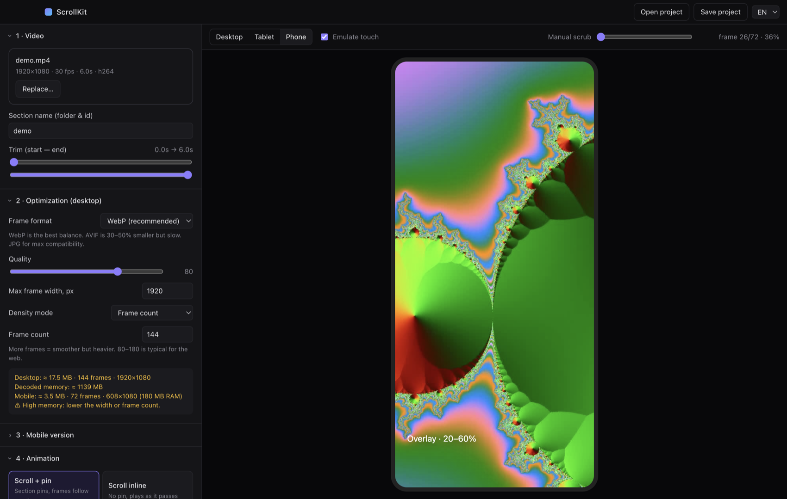

# ScrollKit

**Turn any video into a scroll / mouse / drag / hover driven frame animation for your website — no code, just drop a video.**



[Download](../../releases/latest) · macOS (Apple Silicon + Intel) · Windows 10/11

Desktop app (macOS + Windows) that turns a video into a frame-sequence animation for websites.
Drop a video → optimize → slice into frames → pick how it plays (scroll, mouse, drag, hover, autoplay) → get an embed snippet, a tiny runtime and all assets in one folder.

## How it works
1. **Drop a video**, trim it, choose format (WebP / JPG / AVIF), quality and frame count. The app shows the output weight and decoded memory estimate.
2. **Pick the behaviour** and tune it while watching the live preview (real runtime, not a mock-up).
3. **Export** — copy the embed snippet, upload the folder, done.



### Mobile
Cut a separate, lighter frame set (cropped to 9:16 or from a different video), give it its own breakpoint and its own animation settings. The runtime picks the right set by screen width.

<p align="center"></p>

## Features
- Bundled ffmpeg: trim, resize, WebP / JPG / AVIF, quality, frame count or fps, size + decoded-RAM estimate
- Live preview that runs the **real** runtime (desktop / tablet / phone, touch emulation, manual scrub)
- Triggers: scroll (pinned or inline), mouse X/Y, drag/spin, hover, autoplay (loop, ping-pong)
- Frame range, reverse, easing, inertia, **draggable mapping curve** (e.g. mouse left = 50→0 %, right = 50→100 %)
- Mobile: separate frame set (same video cropped to 9:16 etc., or a different video), breakpoint, mobile-only animation overrides, touch fallback for mouse triggers
- Loading: progressive coarse→fine, lazy start near viewport, concurrency, loader, poster, `prefers-reduced-motion`
- Overlay layers: `<div data-sk-from="0.2" data-sk-to="0.6">` toggles `.sk-active`; `--sk-progress` CSS variable and `scrollkit:progress` event
- Output per section: `desktop/`, `mobile/`, `poster`, `config.json`, `embed.html`, `demo.html`, `project.scrollkit.json` + shared `scrollkit.min.js`

## Install
Grab the installer from [Releases](../../releases/latest). Builds are unsigned: on macOS right-click → Open (or `xattr -cr /Applications/ScrollKit.app`); on Windows choose “More info → Run anyway”.

## Develop
```bash
npm install
npm start
npm run dist:mac   # or dist:win
```
Tags `v*` build installers for macOS (arm64 + x64) and Windows via GitHub Actions.

## Embed
```html
<div data-scrollkit="hero"></div>
<script src="/assets/scrollkit/scrollkit.min.js" defer></script>
```
The section name resolves to `<script dir>/hero/config.json`. Parents of a pinned section must not have `overflow:hidden`.
JS API: `ScrollKit.init(el, cfg, {base})`, `inst.update(cfg)`, `inst.setProgress(0..1)`, `inst.destroy()`.

MIT
